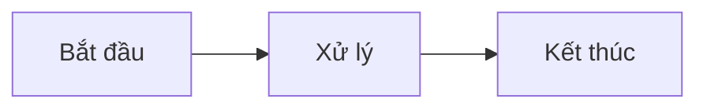

## Khái niệm

Đoạn văn thường: mỗi đoạn là một khối luyện gõ. Hãy viết ngắn gọn, một đến ba câu.

Đây là khối gõ thứ hai. Inline như **đậm**, *nghiêng*, `code` sẽ được gỡ khi chấm điểm.

## Danh sách

- Mỗi mục danh sách là một khối gõ riêng.
- Đây là mục thứ hai.

1. Danh sách có số cũng được tách từng mục.
2. Mục thứ hai của danh sách có số.

## Sơ đồ (chỉ hiển thị, không gõ)



## Code (chỉ hiển thị, không gõ)

```java
public void hello() {
    System.out.println("Hello TypeLearn");
}
```

> Ghi chú: blockquote hiển thị mờ và không bắt gõ. Dùng để bỏ qua một đoạn khỏi luyện gõ.
