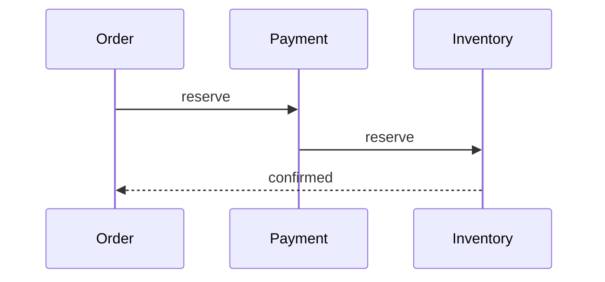

# TypeLearn: web luyện gõ lại kiến thức

Tài liệu mô tả app và kế hoạch phát triển. Mục tiêu: lean, miễn phí, deploy trên EdgeOne Pages.

## 1. Mô tả ngắn

Web lưu kho kiến thức dạng markdown. Người học luyện bằng cách gõ lại từng đoạn văn (kiểu 10fastfingers), kết hợp nghe, nói, đọc, viết. Flow và code chỉ hiển thị để minh hoạ, không phải gõ.

**Người dùng:** một người dùng chính (chủ kho), mở từ bất kỳ thiết bị nào để xem và luyện. Ghi nội dung cần quyền admin, đọc và luyện thì mở.

**Nguyên tắc lean:**
- Không database ngoài, không đăng nhập phức tạp, không backend riêng.
- Âm thanh dùng API có sẵn của trình duyệt (miễn phí, không cần file audio).
- Parse markdown ở client. Server chỉ lưu và trả dữ liệu.

## 2. Bốn kỹ năng nghe, nói, đọc, viết

| Kỹ năng | Chế độ | Cách làm | Bắt buộc? |
|---|---|---|---|
| Đọc | Đọc | Hiển thị đủ đoạn văn, flow, code | Có |
| Viết | Gõ | Gõ lại đoạn văn đang hiện, tô màu đúng/sai theo từng ký tự | Có |
| Nghe | Nghe | Đọc đoạn văn bằng TTS (`speechSynthesis`), chỉnh tốc độ, bật lại | Tuỳ chọn |
| Nghe + Viết | Chép chính tả | Ẩn chữ, chỉ nghe rồi gõ lại | Tuỳ chọn |
| Nói | Nói | Đọc to đoạn văn, nhận dạng bằng `SpeechRecognition`, chấm độ khớp | Tuỳ chọn |

Ghi chú kỹ thuật:
- `speechSynthesis` chạy trên hầu hết trình duyệt. Chất lượng giọng phụ thuộc thiết bị.
- `SpeechRecognition` chủ yếu ổn định trên Chrome/Edge, có thể cần mạng. Nếu không hỗ trợ thì ẩn chế độ Nói, không báo lỗi.
- Mỗi file md có `lang` (ví dụ `en-US`, `vi-VN`) để chọn giọng và ngôn ngữ nhận dạng.

## 3. Quy định format markdown

Một file md là một bài kiến thức. Paste vào app là tự parse.

### 3.1 Front matter (đầu file)

```yaml
---
title: Saga pattern trong microservices
category: Backend
tags: [microservices, distributed, saga]
lang: en-US
---
```

- `title`: bắt buộc. `category`: một giá trị. `tags`: danh sách, tuỳ chọn.
- `lang`: tuỳ chọn, mặc định `en-US`.

### 3.2 Quy tắc phân loại khối

| Thành phần trong md | Vai trò | Gõ? |
|---|---|---|
| Đoạn văn thường | Khối luyện gõ | Có |
| Mục trong danh sách `-` hoặc `1.` | Khối luyện gõ (mỗi mục là một khối) | Có |
| Heading `#`, `##` | Tên phần, dùng làm mục lục | Không |
| Khối ` ```mermaid ` | Vẽ flow/sơ đồ để minh hoạ | Không |
| Khối ` ```java `, ` ```sql `, ... | Hiển thị code có tô màu | Không |
| Blockquote `>` | Ghi chú phụ, hiển thị mờ | Không |
| Ảnh `` | Hiển thị minh hoạ | Không |

Chọn quy tắc "mọi đoạn văn ngoài khối code đều gõ" cho đơn giản. Nếu cần bỏ một đoạn khỏi luyện gõ thì đặt nó trong blockquote.

### 3.3 Ví dụ

````markdown
---
title: Saga pattern
category: Backend
tags: [microservices, saga]
lang: en-US
---

## Khái niệm

A saga is a sequence of local transactions. Each step publishes an event that triggers the next step.



If a step fails, the saga runs compensating transactions to undo the earlier steps.

```java
@SagaStep(compensate = "cancelOrder")
public void createOrder(OrderCmd cmd) { ... }
```

> Ghi chú: orchestration dễ theo dõi hơn choreography khi số bước tăng.
````

Ví dụ trên có 2 khối gõ (hai đoạn văn), 1 flow, 1 code, 1 ghi chú.

### 3.4 Chuẩn hoá khi parse
- Gỡ markdown inline (`**bold**`, `` `code` ``, link) trước khi so khớp, giữ lại text thuần.
- Chuẩn hoá khoảng trắng và dấu nháy thông minh (`’` thành `'`, `“ ”` thành `"`).
- Tuỳ chọn trong phiên luyện: bỏ phân biệt hoa thường, bỏ qua dấu câu.
- Hiển thị trước kết quả parse khi paste (số khối gõ, số flow, số code) để kiểm tra trước khi lưu.

## 4. Tính năng

### MVP
1. Paste md, xem trước kết quả parse, lưu vào kho.
2. Kho kiến thức: danh sách, lọc theo category và tag, tìm theo tiêu đề.
3. Trang bài: chế độ Đọc (đoạn văn, flow, code xen kẽ).
4. Chế độ Gõ: từng khối, tô đúng/sai theo ký tự, hiện WPM và độ chính xác, chuyển khối khi hoàn thành.
5. Tổng kết cuối bài: WPM, độ chính xác, các từ hay gõ sai.
6. Lưu tiến độ trên thiết bị (localStorage).
7. Sửa và xoá bài (cần admin token).

### Giai đoạn sau
- Chế độ Nghe, Chép chính tả, Nói.
- Đồng bộ tiến độ qua nhiều thiết bị.
- Lặp lại ngắt quãng (đoạn nào gõ sai nhiều thì ôn lại sớm hơn).
- PWA, dùng offline.
- Xuất/nhập toàn bộ kho dạng zip md.
- Che từ (cloze): ẩn một số từ trong đoạn và gõ phần bị ẩn.

## 5. Kiến trúc

```
Trình duyệt (static SPA)
   │  GET công khai       ┌──────────────────────────┐
   ├─────────────────────▶│ EdgeOne Pages            │
   │  POST/PUT/DELETE     │  - static hosting        │
   │  (header admin token)│  - Edge Functions /api/* │
   │                      │  - KV (kho bài)          │
   └─────────────────────▶└──────────────────────────┘
```

**Lý do chọn:**
- EdgeOne Pages có sẵn static hosting, Edge Functions và KV nên không cần dịch vụ ngoài.
- Gói miễn phí của KV theo tài liệu hiện tại: 1 GB mỗi tài khoản, tối đa 10 namespace, mỗi giá trị tối đa 25 MB. Rất dư cho kho text.
- KV chỉ gọi được từ **Edge Functions** (không dùng được trong Node Functions).
- KV nhất quán cuối cùng, đồng bộ toàn cầu trong khoảng 60 giây. Sau khi lưu, UI nên dùng ngay dữ liệu trả về thay vì đọc lại.
- Giới hạn có thể thay đổi, hãy kiểm tra lại tài liệu EdgeOne khi triển khai.

**Stack frontend:**
- Vite + Preact (nhẹ) hoặc vanilla JS nếu muốn tối giản hơn.
- `marked` hoặc `markdown-it` để parse md.
- `mermaid` nạp lười (chỉ tải khi bài có flow).
- `highlight.js` (chỉ nạp ngôn ngữ cần dùng).
- Không dùng thư viện UI nặng, tự viết CSS với biến màu.

## 6. Mô hình dữ liệu (KV)

| Key | Giá trị |
|---|---|
| `index` | Mảng metadata: `[{id, title, category, tags, lang, blocks, updatedAt}]` |
| `note:{id}` | `{id, title, category, tags, lang, md, updatedAt}` |

- Lưu một key `index` để danh sách tải bằng một lần đọc, không phải liệt kê hàng loạt (list tối đa 256 mỗi lần).
- Mỗi lần thêm/sửa/xoá: ghi `note:{id}` rồi cập nhật `index`.
- `id` là slug từ tiêu đề cộng hậu tố ngắn ngẫu nhiên.

## 7. API (Edge Functions)

| Method | Đường dẫn | Quyền | Mô tả |
|---|---|---|---|
| GET | `/api/notes` | Công khai | Trả `index` |
| GET | `/api/notes/:id` | Công khai | Trả một bài |
| POST | `/api/notes` | Admin | Tạo bài từ md |
| PUT | `/api/notes/:id` | Admin | Sửa bài |
| DELETE | `/api/notes/:id` | Admin | Xoá bài |

**Bảo vệ ghi:** gửi header `Authorization: Bearer <ADMIN_TOKEN>`. Token lưu ở biến môi trường của project (hoặc một key trong KV), không commit vào repo. Trình duyệt giữ token trong localStorage sau lần nhập đầu. Với app một người dùng thì cách này đủ, không cần hệ thống tài khoản.

**Lưu ý bảo mật:** nội dung md render ra HTML phải được làm sạch (DOMPurify hoặc tắt HTML thô trong parser) để tránh XSS.

## 8. Thiết kế trải nghiệm (UX)

**Nguyên tắc:**
- Luyện gõ là việc chính. Màn hình gõ chỉ có đoạn đang gõ, tiến độ và kết quả.
- Một việc mỗi màn hình: danh sách, đọc, gõ, tổng kết.
- Bàn phím làm được hết: `Enter` sang khối kế, `Esc` thoát, `Tab` chuyển chế độ.
- Mobile dùng được (gõ trên điện thoại, bàn phím ảo không che đoạn đang gõ).
- Hiện đúng/sai bằng cả màu và dấu hiệu khác (gạch chân, nền), không chỉ dựa vào màu.
- Tôn trọng `prefers-reduced-motion` và `prefers-color-scheme`.

**Màn hình:**
1. **Kho:** ô tìm kiếm, bộ lọc category và tag, danh sách bài (tiêu đề, số khối, lần luyện gần nhất).
2. **Thêm bài:** ô paste md, xem trước parse, nút lưu.
3. **Bài (Đọc):** nội dung đầy đủ, mục lục theo heading, nút vào Gõ.
4. **Gõ:** khối hiện tại ở giữa, ký tự đã gõ đúng/sai, thanh tiến độ, WPM và độ chính xác.
5. **Tổng kết:** số liệu, từ gõ sai, nút luyện lại hoặc sang bài khác.

## 9. Skill cho AI agent thiết kế UI/UX

Dùng khi giao agent dựng giao diện:

| Skill | Mục đích |
|---|---|
| `frontend-design` (Anthropic) | Chọn hướng thẩm mỹ, kiểu chữ, bố cục, tránh giao diện mẫu chung chung |
| `edgeone-pages-skills` (tencentedgeone/edgeone-pages-skills) | Hướng dẫn deploy, Edge Functions, KV trên EdgeOne Pages |
| `ui-ux-pro-max` (nextlevelbuilder) | Bộ quy tắc UI/UX, bảng màu, kiểu chữ theo loại sản phẩm |
| `web-design-guidelines` (vercel-labs/agent-skills) | Rà soát giao diện theo checklist: a11y, focus, form, hiệu năng |
| `skill-creator` | Tự viết skill riêng cho app này (xem bên dưới) |

Nên tự viết một skill riêng `typelearn-design` gồm: các quy tắc ở mục 8, token màu/chữ/khoảng cách, quy tắc copy tiếng Việt, checklist trước khi coi một màn hình là xong (mobile, bàn phím, tương phản, trạng thái rỗng và lỗi).

## 10. Cấu trúc thư mục

```
typelearn/
├─ src/
│  ├─ main.jsx
│  ├─ pages/            # Library, AddNote, Note, Typing, Summary
│  ├─ components/       # TypingBlock, CodeBlock, MermaidBlock, TagFilter
│  ├─ lib/
│  │  ├─ parseNote.js   # md -> {meta, blocks[]}
│  │  ├─ typingEngine.js# so khớp ký tự, WPM, accuracy
│  │  ├─ speech.js      # TTS + recognition
│  │  └─ api.js
│  └─ styles/
├─ edge-functions/
│  └─ api/
│     ├─ notes/index.js     # GET list, POST
│     └─ notes/[id].js      # GET, PUT, DELETE
├─ docs/typing-learn-app-plan.md
└─ package.json
```

`parseNote.js` trả về:

```js
{
  meta: { title, category, tags, lang },
  blocks: [
    { type: 'heading', text },
    { type: 'text',    text },          // luyện gõ
    { type: 'flow',    code },          // mermaid, chỉ hiển thị
    { type: 'code',    lang, code },    // chỉ hiển thị
    { type: 'note',    text }
  ]
}
```

## 11. Kế hoạch phát triển

### Giai đoạn 0: Chuẩn bị (0.5 ngày)
- [ ] Tạo repo, project Vite, kết nối EdgeOne Pages (deploy từ Git).
- [ ] Bật KV trong console, tạo namespace, bind vào project với tên biến `my_kv`.
- [ ] Đặt `ADMIN_TOKEN`.
- [ ] Viết skill `typelearn-design`, chốt token màu và chữ.

**Xong khi:** trang trống deploy được và gọi được một API thử đọc/ghi KV.

### Giai đoạn 1: Parser và typing engine (1-2 ngày)
- [ ] `parseNote.js` cho đủ loại khối ở mục 3.2, kèm test với file md mẫu.
- [ ] `typingEngine.js`: so khớp ký tự, xử lý backspace, WPM, accuracy, chuẩn hoá ở mục 3.4.
- [ ] Màn hình Gõ chạy được với dữ liệu mẫu cục bộ.

**Xong khi:** paste md mẫu vào thì thấy đúng số khối, gõ xong một khối có số liệu đúng.

### Giai đoạn 2: Kho kiến thức và API (1-2 ngày)
- [ ] Edge Functions CRUD và kiểm tra token.
- [ ] Màn hình Kho (lọc category/tag, tìm kiếm), Thêm bài (xem trước), Bài (Đọc).
- [ ] Render flow (mermaid nạp lười) và code (highlight).
- [ ] Làm sạch HTML.

**Xong khi:** thêm bài trên máy này, mở trên điện thoại thấy bài và luyện được.

### Giai đoạn 3: Hoàn thiện MVP (1-2 ngày)
- [ ] Tổng kết cuối bài, lưu tiến độ localStorage.
- [ ] Phím tắt, responsive, dark mode, trạng thái rỗng/lỗi/đang tải.
- [ ] Kiểm tra a11y cơ bản (tab, focus, tương phản).
- [ ] Sửa/xoá bài.

**Xong khi:** dùng thật một tuần với bài của chính mình mà không gặp lỗi chặn.

### Giai đoạn 4: Nghe và Nói (1-2 ngày)
- [ ] Chế độ Nghe: TTS từng khối, tốc độ, lặp.
- [ ] Chế độ Chép chính tả: ẩn chữ, nghe rồi gõ.
- [ ] Chế độ Nói: nhận dạng giọng, chấm độ khớp theo từ; ẩn nếu trình duyệt không hỗ trợ.

### Giai đoạn 5: Mở rộng (tuỳ chọn)
- [ ] Đồng bộ tiến độ qua KV bằng mã cá nhân.
- [ ] Lặp lại ngắt quãng.
- [ ] PWA/offline, xuất/nhập zip md, cloze.

## 12. Rủi ro và cách xử lý

| Rủi ro | Cách xử lý |
|---|---|
| KV đồng bộ chậm (đến 60 giây) | Dùng dữ liệu trả về sau khi ghi, không đọc lại ngay |
| `SpeechRecognition` không có trên mọi trình duyệt | Tính năng tuỳ chọn, ẩn khi không hỗ trợ |
| Giọng TTS khác nhau theo thiết bị | Cho chọn giọng và tốc độ, lưu lựa chọn |
| Gõ tiếng Việt có dấu (IME) bị so khớp sai khi đang soạn | Chỉ so khớp sau sự kiện `compositionend` |
| Mất dữ liệu khi lỡ xoá | Nút xuất toàn bộ md, xoá cần xác nhận |
| Giới hạn gói miễn phí thay đổi | Kiểm tra tài liệu EdgeOne trước khi triển khai, giữ dữ liệu dạng md dễ chuyển nơi khác |

## 13. Các điểm cần chốt trước khi code

1. Nội dung chủ yếu tiếng Anh, tiếng Việt, hay trộn? (ảnh hưởng chọn giọng TTS và cách chuẩn hoá khi gõ).
2. Danh sách mục (`-`) có gõ không, hay chỉ đoạn văn thường?
3. Có cần tiến độ đồng bộ giữa các thiết bị ngay MVP không, hay localStorage là đủ?
4. Kho công khai cho mọi người xem, hay chỉ mình bạn? (nếu riêng tư thì cần thêm token cho cả đọc)
